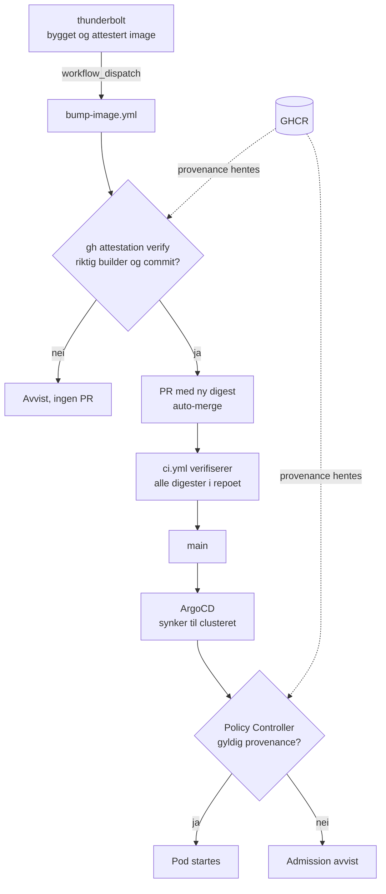

# cluster-config

Dette repoet er fasiten for hva som kjører i Kubernetes-clusteret i byggekjeden vi satte opp etter [SLSA v1.2](https://slsa.dev/spec/v1.2/). Her ligger manifestene, ArgoCD-oppsettet og policyen som avviser images uten gyldig provenance. 


Prosjektet er avsluttet. Bakgrunn, flyt og trusselvurdering ligger i [thunderbolt](https://github.com/the-most-secure-supply-chain-ever-maaan/thunderbolt) og [sikkerhetsrapporten](https://github.com/the-most-secure-supply-chain-ever-maaan/thunderbolt/blob/main/SIKKERHETSRAPPORT.md).

## Repoer

| Repo | Innhold |
|---|---|
| [thunderbolt](https://github.com/the-most-secure-supply-chain-ever-maaan/thunderbolt) | Appens kildekode, Dockerfile og workflowen som starter bygget. Sikkerhetsrapporten ligger her |
| [workflows](https://github.com/the-most-secure-supply-chain-ever-maaan/workflows) | De felles byggeworkflowene som bygger, pusher og attesterer |
| **cluster-config** (dette repoet) | Kubernetes-manifester, ArgoCD-oppsett og trust policies |

## Innhold

| Sti | Hva det er |
|---|---|
| `apps/<app>/deployment.yml` | Deployment og Service. Imaget pinnes til digest, aldri tag |
| `argocd/application.yml` | ArgoCD Application som peker på `apps/thunderbolt` |
| `argocd/readME.md` | Bootstrap-guiden. Les denne for å sette opp et cluster fra bunnen |
| `attestations/trust-policies-values.yml` | Regelen Policy Controller håndhever |
| `kind-config.yaml` | Lokalt kind-cluster, én control-plane og én worker |
| `.github/workflows/bump-image.yml` | Verifiserer provenance og lager PR med ny digest |
| `.github/workflows/ci.yml` | Verifiserer provenance for alle digester i repoet på hver PR |

## Flyt



## Hvordan en ny versjon kommer inn

Bygget i thunderbolt sender ikke inn en endring selv. Det ber om én, og dette repoet avgjør.

1. Thunderbolt henter et kortlivet token for en GitHub App med `actions: write` **bare** på cluster-config, og starter `bump-image.yml` med appnavn, image-digest og commit-SHA-en imaget ble bygget fra.
2. `bump-image.yml` validerer inputene strengt og kjører `gh attestation verify` med `--signer-workflow`, `--source-ref refs/heads/main`, `--source-digest` og `--deny-self-hosted-runners`.
3. Først når det går gjennom, oppdaterer den digesten i `apps/<app>/deployment.yml` og lager en PR med auto-merge.
4. `ci.yml` kjører på PR-en og verifiserer alle digester i `apps/*/deployment.yml` på nytt, uavhengig av hvem som laget PR-en.
5. ArgoCD plukker opp `main` og synker til clusteret.


## Håndheving i clusteret

CI stopper feil digest på vei inn i repoet. Policy Controller stopper feil image på vei inn i clusteret

`attestations/trust-policies-values.yml` sier at alt under `ghcr.io/the-most-secure-supply-chain-ever-maaan/**` må ha en `https://slsa.dev/provenance/v1`-attestasjon signert av `build.yaml` i workflows-repoet. Regelen gjelder bare i namespace som har labelen `policy.sigstore.dev/include=true`

Rask test på et oppsatt cluster:

```sh
kubectl run test --image=nginx:latest
```

Forventet svar er at admission-webhooken avviser den med `no matching policies`, og at ingen pod opprettes.

## Sette opp et cluster

Bootstrap gjøres manuelt én gang per cluster. Stegvis guide med kommandoer, verifisering og feilsøking ligger i [argocd/readME.md](./argocd/readME.md).

Kort fortalt: kind-cluster → ArgoCD → Sigstore Policy Controller → trust policies → label på namespacet → `argocd/application.yml`.

## Legge til en ny app

1. Lag `apps/<app>/deployment.yml` med imaget pinnet til digest. Mappenavnet må være appnavnet, og det må matche navnet på kilderepoet — `ci.yml` og `bump-image.yml` utleder begge imagenavn og repo fra mappenavnet.
2. Lag en ArgoCD Application for den, etter mønsteret i `argocd/application.yml`.
3. La kilderepoet kalle `build.yaml` i workflows-repoet og be om bump, slik thunderbolt gjør.


## Les mer

- [SLSA-spesifikasjonen v1.2](https://slsa.dev/spec/v1.2/)
- [Sigstore Policy Controller](https://docs.sigstore.dev/policy-controller/overview/)
- [GitHub: Enforcing artifact attestations in Kubernetes](https://docs.github.com/actions/security-for-github-actions/using-artifact-attestations/enforcing-artifact-attestations-with-a-kubernetes-admission-controller)
- [ArgoCD](https://argo-cd.readthedocs.io/)
